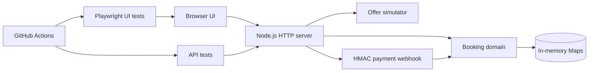

# Architecture and design rationale

## Components

- `src/server.js`: lightweight HTTP transport, request routing, body-size protection and local static asset serving.
- `src/domain.js`: business rules and state transitions, HMAC signing/verification, duplicate detection and stock reservation.
- `src/public/`: responsive HTML/CSS/JavaScript UI with stable `data-testid` hooks.
- `tests/domain/`: pure business-rule checks without network dependencies.
- `tests/api/`: real HTTP contract/negative tests using ephemeral localhost server per test.
- `tests/ui/`: Playwright journey tests through a real Chromium browser, sharing no persistent session or user data.
- `.github/workflows/ci.yml`: two separate jobs - one for native API checks and one for UI browser checks.

## A typical successful flow

1. Browser reads `/api/offers` and displays a synthetic fare and available capacity.
2. Browser posts booking with passenger data and offer ID.
3. API validates input and inventory, generates an opaque booking ID, reserves one seat, returns `PENDING_PAYMENT`.
4. A fake sandbox action generates an HMAC-signed payment event, processed through the same domain method as a webhook.
5. Domain verifies event ID, signature, amount, and allowed state transition; updates status to `CONFIRMED`.
6. Browser refreshes booking and inventory; the synthetic refund button is allowed only after confirmation.

## Payment design choices

- Verify signature over **raw** request body before modifying booking state.
- Ensure **at-most-once logical application** for exact duplicate event IDs and bodies; conflicting payload reuse fails.
- Do not trust client-supplied payment amount or booking fare.
- Return deterministic structured errors and accurate HTTP status codes.
- No actual payment, bank account, provider SDK or external network call.

## Testability choices

- Domain state is injected per HTTP server instance, eliminating cross-test contamination.
- `localhost` binding reduces accidental exposure.
- Fixed synthetic offer and amount keep assertions deterministic.
- `data-testid` attributes avoid brittle browser selectors based on visual layout.
- Business rules and tests share traceability IDs, not hard-coded customer identifiers.
- AI can draft new cases, but a human reviewer must approve expected results and claims in release reports.

## Potential next iterations

Introduce DB persistence and cleanup fixtures; add integration contract schema validation; test race conditions on the final seat; introduce a separate admin role; implement an observable payment event audit; add accessibility checks; and use a strict split between mock-provider and end-to-end integration environments. These are **future ideas**, not current implemented features.