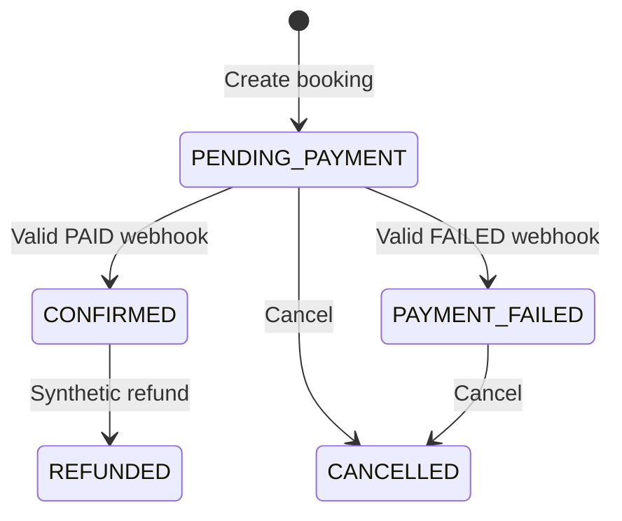

# Requirements and business rules

**System under test:** Fictional booking and payment quality lab. These are self-authored sample requirements, not requirements from any customer product.

| ID | Business rule / acceptance criteria | Notes |
| --- | --- | --- |
| BR-01 | Offer lookup returns ID, route, fare, currency and seats available. | One synthetic offer; SGN-HAN; VND |
| BR-02 | A booking requires valid first name, last name, email and an existing offer ID. | Name 1-60 characters; email basic format (not production RFC validation) |
| BR-03 | Booking price and currency are server-controlled. | Ignore client-supplied amount/currency to prevent price tampering |
| BR-04 | Booking creation reserves one seat and sets status PENDING_PAYMENT. | Capacity 3 in current mock |
| BR-05 | Sold-out offer cannot be booked and returns 409. | Race/performance behavior is out of scope |
| BR-06 | A pending booking can be cancelled; cancellation releases the reserved seat exactly once. | Duplicate cancellation returns 409 |
| BR-07 | Paid callback changes PENDING_PAYMENT to CONFIRMED. | Valid signature, booking ID and exact amount required |
| BR-08 | Failed callback changes PENDING_PAYMENT to PAYMENT_FAILED and releases capacity. | No real money moves |
| BR-09 | Webhook uses HMAC SHA-256 signature over raw request body. | Invalid/missing signature returns 401 |
| BR-10 | Duplicate event ID and exact payload are idempotent. | A changed payload with same event ID returns 409 |
| BR-11 | A mismatching payment amount returns 422 and does not settle the booking. | Under/overpayment tested |
| BR-12 | Invalid or out-of-order state transition returns 409. | E.g. second payment on confirmed booking |
| BR-13 | Refund is available only for CONFIRMED bookings and updates status to REFUNDED. | Synthetic refund; demonstration releases seat, not a real airline business rule |
| BR-14 | Missing/invalid resource or payload returns an explicit non-2xx error. | 400, 404, 413, 409, 422 as applicable |
| BR-15 | Partner simulator can return success, unavailable (503), or invalid data (502). | Deterministic, no HTTP call to a partner |
| BR-16 | Public UI shows offer, available seats, booking ID, status and permitted actions. | Buttons disabled based on current status |
| BR-17 | Every test uses synthetic customer information. | No customer data, secrets or external systems |
| BR-18 | Build/test workflow is non-destructive and uses only isolated local/CI mock servers. | GitHub Actions has no schedule or production access |

## State machine

## Assumptions and trade-offs

The single offer and fixed price are deliberately simplified. Currency precision, passenger identity verification, PNR issuance, fraud controls, partial capture, real refunds, concurrent reservations, authentication, provider SLAs and database persistence are out of scope. HMAC protects the mocked callback integrity, but the repo is not a security-complete payment service. These assumptions must be called out in a QA report instead of silently treated as a production design.